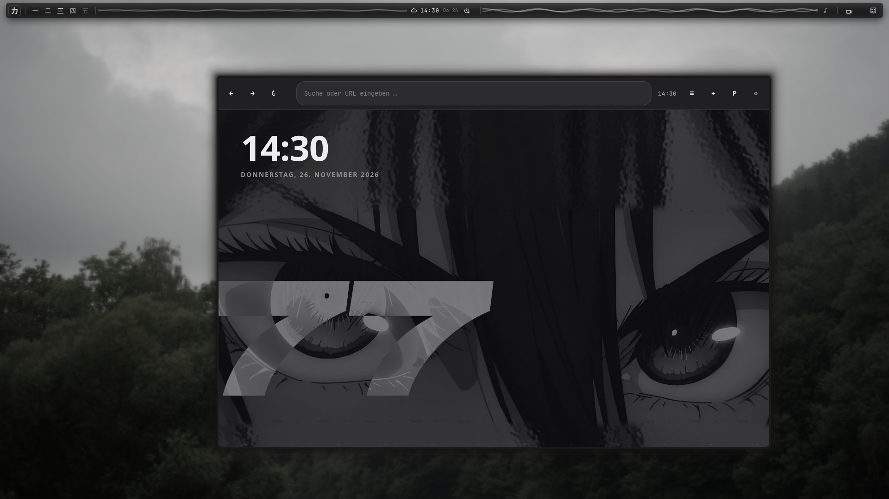
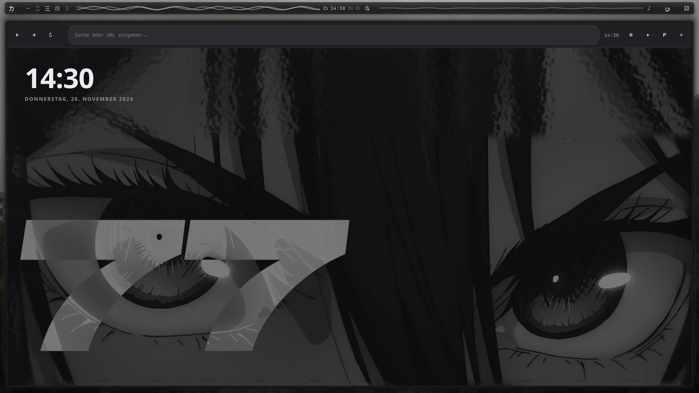
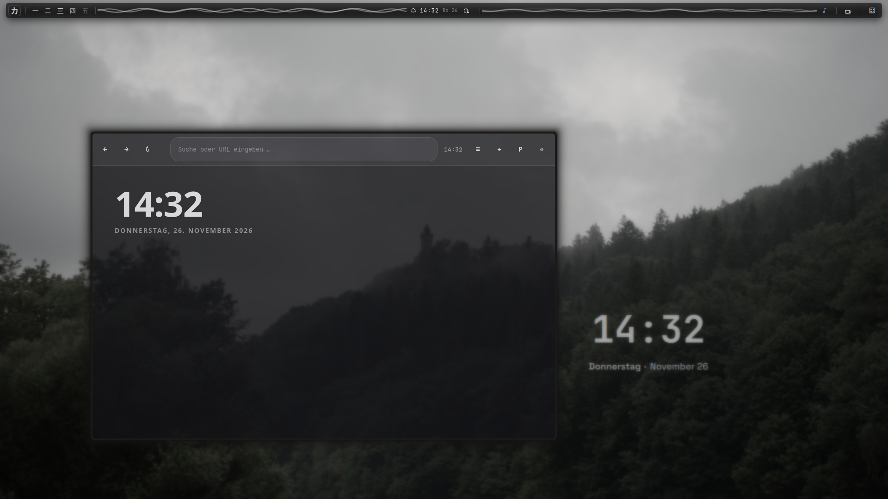

# lumen-1_browser

Ein schlanker Browser für Arch Linux und Wayland mit GTK3 und WebKitGTK.

## Features

- Leichtgewichtig und schnell
- Sauberes Design mit flüssigen Animationen
- Farben passen sich dem gewählten Wallpaper an

## Screenshots





 (Transparenzmodus 70% )


## Installation

### Release

```bash
mkdir lumen-browser && cd lumen-browser
curl -LO https://github.com/s72sy4/lumen-1_browser/releases/download/v0.1.4/aur-submission.tar.gz
tar -xzf aur-submission.tar.gz
makepkg -si
```

`aur-submission.tar.gz` enthält `PKGBUILD` und `.SRCINFO`. Der Source-Tarball liegt ebenfalls im Release.

### Aus dem Quellcode

```bash
git clone https://github.com/s72sy4/lumen-1_browser.git
cd lumen-1_browser
cargo build --release
./target/release/lumen-1_browser
```

Benötigt: `rust`/`cargo`, `gtk3`, `webkit2gtk-4.1`. Für `makepkg` zusätzlich `base-devel`.

## Tastenkürzel

| Kürzel | Funktion |
| --- | --- |
| `Strg+L` | Tab-Liste ein-/ausblenden |
| `Strg+T` | Neuer Tab |
| `Strg+W` | Tab schließen |
| `Strg+K` | Adressleiste fokussieren |
| `Strg+D` | Lesezeichen |
| `Strg+Shift+N` | Privater Tab |
| `Strg+,` | Einstellungen |
| `Esc` | Overlays schließen |

## Wallpapers

Die mitgelieferten Wallpapers liegen unter `assets/wallpapers`. In den Einstellungen können zusätzlich eigene Bilder aus dem Pictures-Verzeichnis oder per Datei-Dialog gewählt werden; die Akzentfarben passen sich sofort an.
